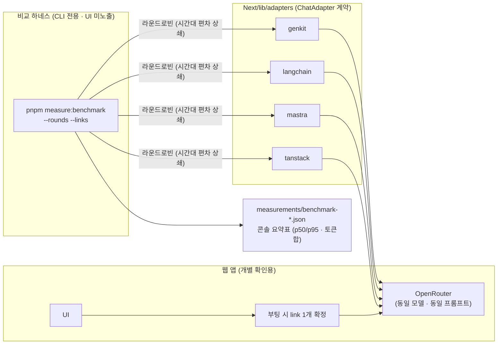

# blog-to-social-post
Write Social Network Service(SNS) Article based Blog Article.

동일 기능을 AI 프레임워크별로 구현해 비교 검증하는 모노레포 (상세: [`AGENTS.md`](./AGENTS.md)).

- [`Next/`](./Next/README.md) — Next.js 통합 구현, `pnpm dev link=genkit|langchain|mastra|tanstack`으로 AI 연결 선택 (동작 검증됨)
- [`SpringAI/`](./SpringAI/README.md) — Kotlin + Spring AI 구현 (동작 검증됨, JVM/Gradle, pnpm 대상 아님)
- [`Koog/`](./Koog/README.md) — Kotlin + JetBrains Koog 구현 (동작 검증됨, JVM/Gradle, pnpm 대상 아님)

## 구조 다이어그램

## 측정 방식

품질이 아니라 **연동 방식의 차이**를 재는 것이 목적이다. 각 프레임워크는 얇은 어댑터를 제공하고,
공통 하네스가 같은 프롬프트를 쏴서 측정한다.

1. **어댑터**: `POST /chat {prompt, model?, maxTokens?}` → `{output, usage, latencyMs, attempts, model, costUsd}`.
   재시도 없이 1회 호출이 원칙 (순수 연결 성능 측정). 기준 구현: `Next/` (스펙 상세는 [`Next/AGENTS.md`](./Next/AGENTS.md)).
2. **쏘기**: `cd Next && pnpm dev link=genkit` 후 `/api/chat` 호출. 매 호출은 `measurements/<link>.jsonl`에 1줄씩 기록된다.
   일괄 비교는 `pnpm measure:benchmark` (서버 기동 불필요, 위 다이어그램 참조).

## 비교 결과 (예비치, 2026-10-14)

동일 모델(`nvidia/nemotron-3-ultra-550b-a55b:free`)·동일 키, 서버 측 `latencyMs` 실측.
표본이 적고 무료 티어 편차가 크므로 확정치가 아니라 경향치로 볼 것.

| link | chat latency | convert latency | usage 분해 | 비고 |
|---|---|---|---|---|
| genkit | 56,576ms (n=1) | p50 39,170ms (n=7) | 3종 완전 | 구조화 검증 내장, 의존 최중량 |
| langchain | p50 897ms (n=2) | p50 71,030ms (n=2) | total만 (`:free` 한계) | 가볍고 안정, 출력 미검증 |
| mastra | 5,110ms (n=1) | 16,370ms (n=1) | 3종 완전 | `maxSteps: 1` 1회 호출, 의존 무거움 |
| tanstack | 1,089ms (n=1) | 5,746ms (n=1) | 3종 완전 | 가장 빠름, RC 버전·zod v3 변환 필요 |

- 비용은 전부 `costUsd=0` (무료 모델).
- 확정 비교는 `pnpm measure:benchmark --rounds=10` (프롬프트 고정·라운드로빈) 후 p50/p95으로 판정.
3. **집계**: `pnpm measure:report [--kind=chat|convert]` → 지연시간 분포 + 토큰합 + 비용합 출력, `report.csv` 저장.

## 측정 기준

| 항목 | 기준 |
|---|---|
| 모델 | 전 프레임워크가 접근 가능한 1개로 고정, `temperature: 0` + seed 고정 (미확정 — 정해지면 단가표·어댑터에 반영) |
| 프롬프트 | 실제 태스크(스케줄러 요약 등) 10~20개로 고정, 전 어댑터 동일 세트 |
| 지연시간 | 서버 측 `latencyMs` 기준 `p50`/`p95` (네트워크 제외). 스트리밍 시 TTFT 추가 (어댑터 확장 필요) |
| 토큰·비용 | `usage.{promptTokens,completionTokens,totalTokens}` + 단가표 → `costUsd`. 미등록 모델은 `null` |
| 재시도 | 어댑터는 재시도 금지, `attempts`로 시도 횟수 기록. `/convert`는 503/429 재시도하므로 `latencyMs`가 총소요 |
| 도구호출 | function calling 비교 포함 여부 미결정 — 포함 시 어댑터에 도구 정의·호출 성공률 필드 추가 |
| 출력 길이 | 모델이 `maxTokens` 상한을 무시할 수 있음(실측 확인). 길이 통제는 프롬프트 지시로 보완 |
