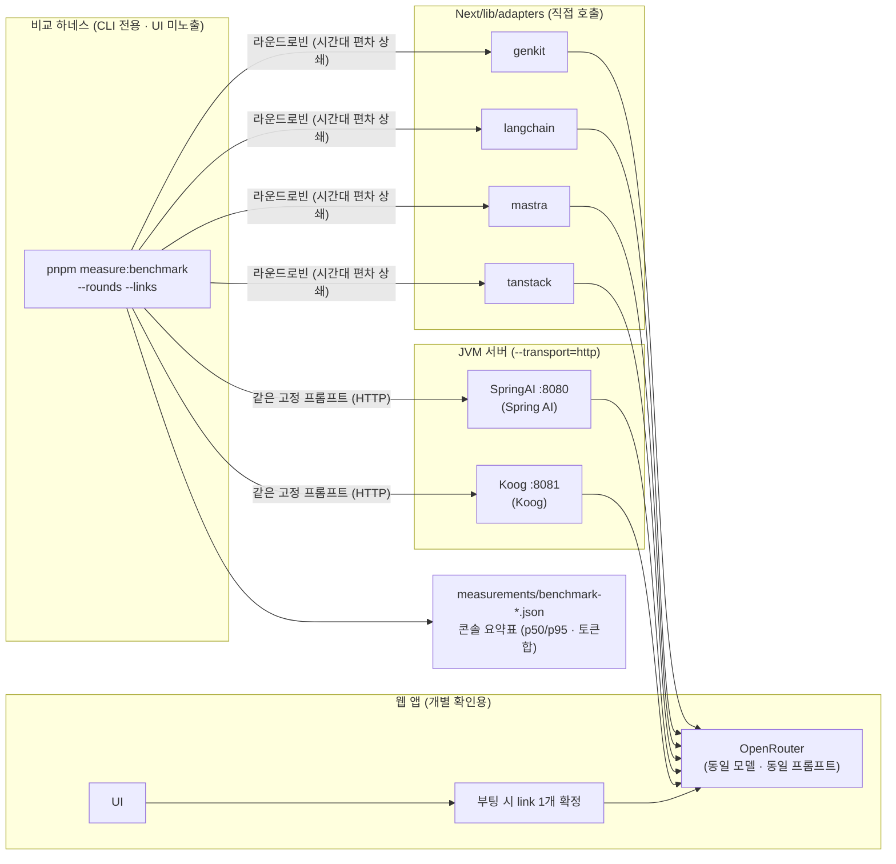
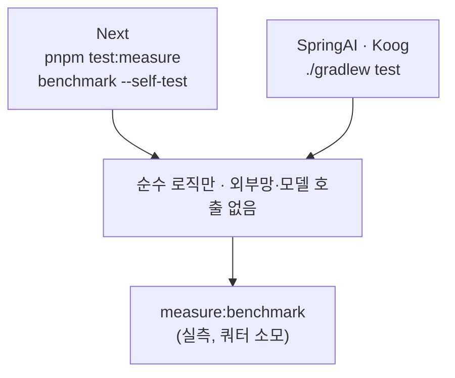

# blog-to-social-post
Write Social Network Service(SNS) Article based Blog Article.

동일 기능을 AI 프레임워크별로 구현해 비교 검증하는 모노레포 (상세: [`AGENTS.md`](./AGENTS.md)).

- [`Next/`](./Next/README.md) — Next.js 통합 구현, `pnpm dev link=genkit|langchain|mastra|tanstack`으로 AI 연결 선택 (동작 검증됨)
- [`SpringAI/`](./SpringAI/README.md) — Kotlin + Spring AI 구현 (동작 검증됨, JVM/Gradle, pnpm 대상 아님)
- [`Koog/`](./Koog/README.md) — Kotlin + JetBrains Koog 구현 (동작 검증됨, JVM/Gradle, pnpm 대상 아님)

## 구조 다이어그램

## 측정 방식

품질이 아니라 **연동 방식의 차이**를 재는 것이 목적이다. 각 프레임워크는 얇은 어댑터를 제공하고,
공통 하네스가 같은 프롬프트를 쏴서 측정한다.

1. **어댑터**: `POST /chat {prompt, model?, maxTokens?}` → `{output, usage, latencyMs, attempts, model, costUsd}`.
   재시도 없이 1회 호출이 원칙 (순수 연결 성능 측정). 기준 구현: `Next/` (스펙 상세는 [`Next/AGENTS.md`](./Next/AGENTS.md)).
2. **쏘기**: `cd Next && pnpm dev link=genkit` 후 `/api/chat` 호출. 매 호출은 `measurements/<link>.jsonl`에 1줄씩 기록된다.
   일괄 비교는 `pnpm measure:benchmark` (서버 기동 불필요, 위 다이어그램 참조).

## 테스트 (쿼터 소모 없음)

| 위치 | 명령 | 범위 |
|---|---|---|
| Next | `pnpm test:measure` | 분위수·분포 요약·usage 정규화(TS 4종 + Koog형)·단가표·JSONL 기록 |
| Next | `benchmark --self-test` | 하네스 인자 파싱·toUsage·에러 경로 (네트워크 없음) |
| SpringAI | `./gradlew test` | 프롬프트 규칙·trim·플랫폼 정규화·본문 추출 parity 11건 |
| Koog | `./gradlew test` | 동일 10건 (kotlin.test) |

- `test-provider.mts`, 실서버 스모크, 하네스 본실행은 실제 모델을 쏘므로 쿼터를 쓴다. 일상 검증은 위 표만으로 끝낸다.

## 비교 결과 (예비치, 2026-10-14)

동일 모델(`nvidia/nemotron-3-ultra-550b-a55b:free`)·동일 키, `latencyMs` 실측.
표본이 적고 무료 티어 편차가 크므로 확정치가 아니라 경향치로 볼 것.

### A. chat — 동일 프롬프트 3종 (하네스 고정 세트)

| link | latency | n | 비고 |
|---|---|---|---|
| genkit | 56,576ms | 1 (스모크) | 하네스는 env 버그로 0/12 → 수정 후 쿼터 소진으로 재측정 보류 |
| langchain | p50 1,538ms | 6 | |
| mastra | p50 3,231ms | 6 | |
| tanstack | p50 5,004ms | 3 | |
| springai | 2,224ms | 1 (스모크) | HTTP 모드, 동일 프롬프트 |
| koog | 1,632ms | 1 (스모크) | HTTP 모드, 동일 프롬프트 |

### B. convert — 실물 글 (justuser.tistory.com/44, remember 중심)

| link | latency | n | 비고 |
|---|---|---|---|
| genkit | p50 39,170ms | 7 (서버 로그) | |
| langchain | 44,796 / 97,264ms | 2 | 편차 큼 |
| mastra | 16,370ms | 1 | |
| tanstack | 5,746ms | 1 | |
| springai | 20,468ms | 1 | |
| koog | 37,174ms | 1 | 전체 스키마 전송 후 서버에서 필터 |

### C. 토큰·비용·구조화

- usage 3종 완전: genkit, mastra, tanstack, springai, koog.
  langchain은 `:free` 모델에서 total만 내려 prompt/completion이 0으로 기록된다.
- 비용은 전부 `costUsd=0` (무료 모델).
- 구조화: genkit만 네이티브 검증(response_format). 나머지는 스키마 지시 + 후처리
  (langchain response_format / mastra structuredOutput / tanstack JSON 스키마 /
  springai MapOutputConverter / koog 수동 모드).

### 방법론·제약

- 하네스(`pnpm measure:benchmark`): TS 4종은 직접 호출, JVM 2종은 HTTP로 동일 프롬프트·라운드로빈.
- 2026-10-14 풀매트릭스 도중 무료 일일 한도(50회) 소진 → rounds 2~3 상당수가 429로 실패.
  위 수치는 성공분만 집계했고, 쿼터 회복 후 `rounds=5` 재측정으로 확정한다.
- 하네스에서 genkit 어댑터의 import 시점 env 캡처 버그 발견·수정
  (`.env.local`을 뒤늦게 읽는 실행에서 키를 못 읽음 → 첫 호출 시 lazy 생성으로 변경).

### 결론 (예비)

- 속도: tanstack·koog·springai가 선두권, genkit이 최하. 단 표본이 적어 순번 확정은 보류.
- 측정 완전성: langchain만 usage 분해 결함. 비용 비교가 목적이면 제외하거나 total 안분 규칙 필요.
- 제품 경로 후보: tanstack(속도+측정) 또는 mastra(검증+측정+생태계). genkit은 대조군 유지.
3. **집계**: `pnpm measure:report [--kind=chat|convert]` → 지연시간 분포 + 토큰합 + 비용합 출력, `report.csv` 저장.

## 측정 기준

| 항목 | 기준 |
|---|---|
| 모델 | 전 프레임워크가 접근 가능한 1개로 고정, `temperature: 0` + seed 고정 (미확정 — 정해지면 단가표·어댑터에 반영) |
| 프롬프트 | 실제 태스크(스케줄러 요약 등) 10~20개로 고정, 전 어댑터 동일 세트 |
| 지연시간 | 서버 측 `latencyMs` 기준 `p50`/`p95` (네트워크 제외). 스트리밍 시 TTFT 추가 (어댑터 확장 필요) |
| 토큰·비용 | `usage.{promptTokens,completionTokens,totalTokens}` + 단가표 → `costUsd`. 미등록 모델은 `null` |
| 재시도 | 어댑터는 재시도 금지, `attempts`로 시도 횟수 기록. `/convert`는 503/429 재시도하므로 `latencyMs`가 총소요 |
| 도구호출 | function calling 비교 포함 여부 미결정 — 포함 시 어댑터에 도구 정의·호출 성공률 필드 추가 |
| 출력 길이 | 모델이 `maxTokens` 상한을 무시할 수 있음(실측 확인). 길이 통제는 프롬프트 지시로 보완 |
