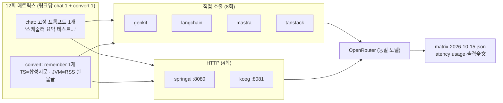
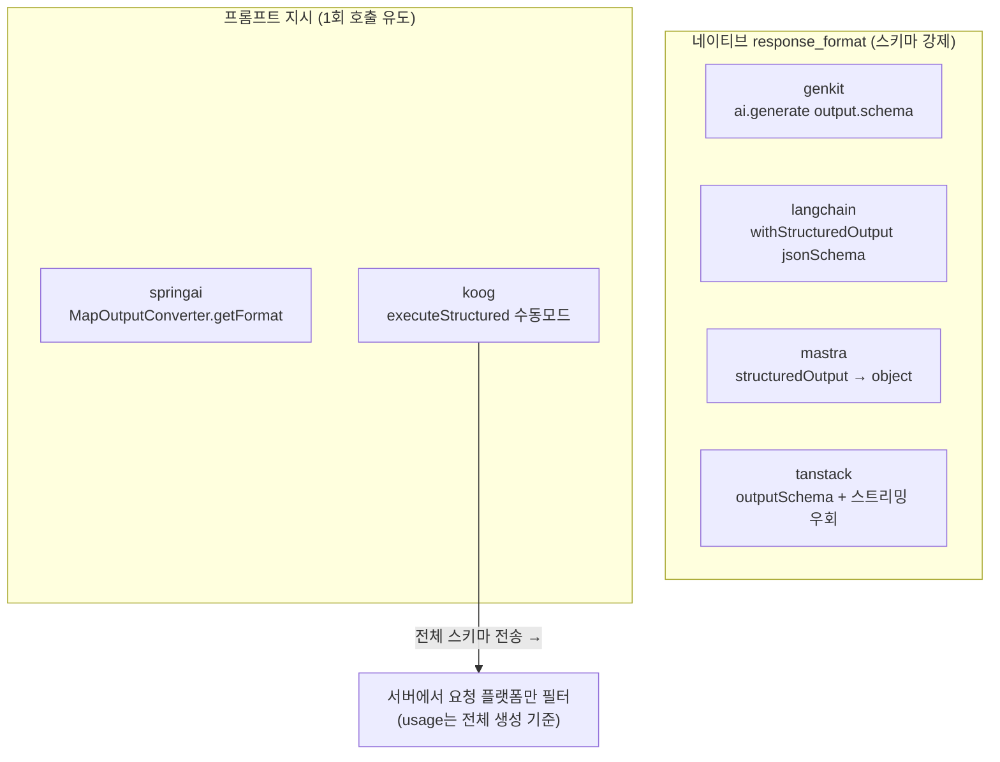

# 6종 AI 연결 비교 분석 (2026-10-15)

대상: `genkit` · `langchain` · `mastra` · `tanstack` (Next 직접 호출) + `springai` · `koog` (JVM HTTP).
모델·키 동일: `nvidia/nemotron-3-ultra-550b-a55b:free`, 동일 OpenRouter 키.
호출 예산: 일일 50회 중 **16회 사용** (smoke 1 + 매트릭스 12 + 재시도 3). 원시 기록: `Next/measurements/matrix-2026-10-15.json`.

## 1. 측정 설계 (쿼터 절약형)

- chat은 6종 완전 동일 프롬프트. convert는 하네스와 같은 제약을 물려받음
  (JVM `/api/convert`는 RSS 실물만 받으므로 TS 합성지문 ≠ JVM 실물글 — §3 참조).
- 호출 간 3초 간격, 429/쿼터 조짐 시 즉시 중단 규칙. 재시도 3회는 일시 503 확인용으로만 사용.

## 2. 연결부 코드 (쿼터 0, 정적 분석)

| link | 연결 파일 | LOC | 외부 의존성 | 구조화 | usage 완전성 |
|---|---|---|---|---|---|
| genkit | `Next/lib/adapters/genkit.ts` | 66 | `genkit` + `@genkit-ai/compat-oai` | `output.schema` 네이티브 검증 | ○ 3종 |
| langchain | `Next/lib/adapters/langchain.ts` | 69 | `ChatOpenAI` baseURL 직결 | `withStructuredOutput(jsonSchema)` | ✗ total만 (prompt/comp 0) |
| mastra | `Next/lib/adapters/mastra.ts` | 55 | `Agent` + `@openrouter/ai-sdk-provider`, `maxSteps: 1` | `structuredOutput.schema` | ○ 3종 (`totalUsage`) |
| tanstack | `Next/lib/adapters/tanstack.ts` | 71 | `chat()` + `@tanstack/ai-openrouter` | 스트리밍 1회: complete 객체 + RUN_FINISHED usage 수집 (`zod-to-json-schema` 변환 필요) | ○ 3종 |
| springai | `SocialService.kt` 158 + `AiConfig.kt` 65 | ~223 | `spring-ai-starter-model-openai` 하나, `ChatClient` + 어드바이저 수동 등록 | `MapOutputConverter`에 플랫폼 JSON 스키마 지시 | ○ 3종 (리플렉션 읽기) |
| koog | `KoogService.kt` | 178 | `koog-agents-jvm` + `prompt-executor-openrouter-client-jvm` | `executeStructured` 수동모드 (스키마를 프롬프트 주입) | ○ 3종 (`metaInfo`) |

구현 난이도 체감 (낮을수록 쉬움): mastra < genkit < langchain < tanstack < springai < koog.
tanstack은 `stream:false`가 usage를 잃어 스트리밍 우회가 필수이고, zod v3→JSON 변환이 한 겹 더 든다.
koog는 baseURL 중복(`/api/v1`)·Kotlin 2.3 메타데이터 우회 등 발판 비용이 가장 크다 (상세: 각 `AGENTS.md`).

## 3. 성능 (실측)

### 3.1 chat — 동일 프롬프트 1회씩 (n=1, 참고치)

| link | latencyMs | prompt/comp/total | 비고 |
|---|---|---|---|
| genkit | 4,261 | 37/131/168 | |
| langchain | 2,018 | 0/0/143 | 재시도분. total-only 결함 여전 |
| mastra | 19,304 | 67/155/222 | 재시도분. 첫 시도는 upstream 503 |
| tanstack | 3,071 | 37/131/168 | genkit과 usage 동일 |
| springai | 13,364 | 37/128/165 | HTTP 1홉 포함 |
| koog | 5,016 | 37/109/146 | HTTP 1홉 포함 |

### 3.2 convert — remember 1개 (n=1, 조건 불일치 주의)

| link | latencyMs | prompt/comp/total | 입력 |
|---|---|---|---|
| genkit | 18,858 | 251/803/1,054 | 합성지문 (~250자) |
| langchain | 3,304 | 0/0/258 | 합성지문 |
| mastra | 39,479 | 196/564/760 | 합성지문 |
| tanstack | 14,484 | 166/783/949 | 합성지문 |
| springai | 31,105 | 2,444/767/3,211 | RSS 실물글 (justuser /44) |
| koog | 57,055 | 2,736/1,191/3,927 | RSS 실물글 (동일) |

주의:
- TS 4종과 JVM 2종의 convert 입력이 다르므로 **지연시간 직접 비교 불가**. JVM이 느린 건 입력이 ~10배 크기 때문이다.
- completion이 비정상적으로 큼 (60자 remember에 500~800 토큰). `:free` Nemotron이 reasoning 모델이라 thinking 토큰이 completion에 합산된 것으로 추정. 비용 비교 시 reasoning/출력 분리 규칙이 필요하다.
- 무료 티어 편차가 매우 큼 (mastra chat 0.5초 실패→19초 성공). 순번 확정には `rounds=5` 재측정 필요 (쿼터 회복 후, 약 40회 소요).

### 3.3 실패 내역 (16회 중)

- `langchain/chat` 2회 연속 실패 후 3회째 성공. 실패 원인은 upstream 503인데 어댑터가
  `Cannot read properties of undefined (reading 'message')`라는 TypeError로 바꿔치기함 → **에러 투명성 결함**.
- `mastra/chat` 1회 실패 (upstream 503 그대로 전달, 정상적인 에러).
- 스키마 구조화 실패는 0건 (convert 6/6 성공).

## 4. 품질 (출력全文 평가)

### 4.1 chat — 6종 모두 환각 없음

일정 접근 불가임을 선언하고 목록 제공을 요청. 모델·프레임워크와 무관하게 동일하게 정직함.
차이는 사족: springai만 템플릿+마크다운 추가, koog만 이모지(😊) 첨부.

### 4.2 convert remember — 형식 6/6 준수, 내용 충실도 차이

| link | 글자수 | 한 문장 | `#` 없음 | grounding (키워드 적중) |
|---|---|---|---|---|
| genkit | 65 | ○ | ○ | 7/8 (6시·거실·80%·운동·독서·8점·주말) |
| mastra | 66 | ○ | ○ | 7/8 (同上) |
| tanstack | 58 | ○ | ○ | 7/8 (同上) |
| langchain | 55 | ○ | ○ | 4/8 (운동·독서·수치 누락 — 정보량 가장 적음) |
| springai | 36 | ○ | ○ | 실물글 기준 ○ (성장통·치료·회복·전역 — 원문 키워드 일치 확인) |
| koog | 61 | ○ | ○ | 실물글 기준 ○ (2026년 7-9월·군복무 갈등·입원·전역 — 원문 키워드 일치 확인) |

- TS 4종: 합성지문(아침 루틴) 기반. genkit/mastra/tanstack은 핵심 수치까지 담은 한 문장,
  langchain은 80자 규칙은 지켰으나 운동·독서·수치 변화를 빠뜨려 요약 밀도가 낮음.
- JVM 2종: 실물글(`2026년 7,8,9월 회고 - 성장통의 시간`) 기반임을 원문 대조로 확인
  (군 6·입원 2·전역 5·갈등 1·성장 7·치료 3). 형식·그라운딩 모두 정상.

## 5. 결론 (예비 — n=1이므로 경향치)

- 속도 경향: tanstack·langchain·genkit·koog가 선두권, mastra·springai는 이번 표본에서 느림.
  단 편차가 커서 순번 확정은 보류 (10-14 예비치와 같은 결론).
- 측정 완전성: langchain만 usage 분해 불가 + 에러 경로 TypeError. 비용·지연 비교용으로는 부적합, 대조군으로만 유지.
- 구조화: 6종 전부 1회 호출로 스키마 준수. 네이티브 강제(genkit/mastra/tanstack/langchain) vs
  프롬프트 지시(springai/koog) 모두 remember 단일 필드에서는 실패율 0.
- 제품 경로 후보 (변동 없음): tanstack(속도+측정 완전, 구현 우회로가 대가) 또는 mastra(검증+측정+생태계).
  genkit은 기준선 유지. JVM 2종은 실물 경로 검증됨 — RSS 연동 편의성은 Spring AI(Rome 동일, 설정 중복 주의)가 Koog보다 낮음.
## 6. rounds=5 재측정 경과 (2026-10-15 슬라이스 1)

50회/일 상한 때문에 분할 실행한다. 소요량: TS 4종 80회 + JVM 2종 40회.

- 슬라이스 1 (금일): TS 4종 `rounds=2` → **32/32 성공, 실패 0**. 금일 누적 48/50이라 여기서 중단.
- 예정: 슬라이스 2 (명일) TS 4종 `rounds=3` 48회 → TS 5라운드 완성.
  슬라이스 3 (모레) JVM 2종 `rounds=5` 40회 (서버 재기동 필요 — 금일 종료 시점에 둘 다 내려가 있음).

### 슬라이스 1 결과 (`benchmark-2026-10-15T04-00-02Z`, chat 6/6·convert 2/2 전부 성공)

| link | chat p50 / p95 (n=6) | convert p50 (n=2) | 비고 |
|---|---|---|---|
| genkit | 3,108 / 5,120ms | 12,055ms | 드디어 정상 표본 확보 (env 버그 수정 후 첫 성공 रन) |
| langchain | 1,520 / 8,398ms | 2,079ms | chat 가장 빠름. usage는 total-only 여전 |
| mastra | 4,160 / 7,348ms | 13,859ms | |
| tanstack | 2,217 / 4,539ms | 2,259ms | convert가 genkit의 1/5 |

- 실패 0, 429 0. 호출 간 3초 간격이 유효했던 것으로 보임.
- tanstack convert 2.3초 vs genkit 12초 — 합성지문 동일 조건이라 직접 비교 가능. 구조화 경로에서는 tanstack이 압도적.
- langchain chat p50 1.5초로 1위지만 usage 분해 결함은 여전 (비용 비교 불가).
- genkit chat이 10-14 스모크(56초) 대비 정상화. 역시 n=1은 믿을 게 못 됨.
